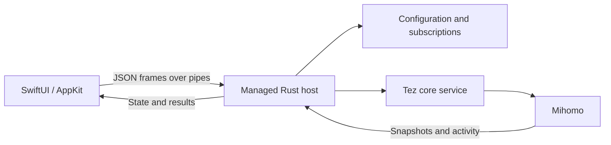

# Tez Native

The macOS application uses SwiftUI/AppKit, a managed Rust host, and the Tez core service.

## Requirements

- macOS with an Apple Silicon development machine.
- Xcode or Command Line Tools with Swift 6 and the macOS 26 SDK.
- Rust 1.99.1, as recorded in `../rust-toolchain.toml`.
- Node.js and pnpm, as recorded in `../package.json`.

The packaged application targets macOS 14 and later.

## Prepare Resources

Run from the repository root:

```sh
pnpm install --frozen-lockfile
pnpm prebuild
node native/package-core.mjs --source-check
```

Resource preparation supplies the Mihomo binaries and geographic databases under `src-tauri/sidecar` and `src-tauri/resources`. The native package includes two core variants, four databases, and the DNS helper scripts.

## Build the Application

Run from the repository root:

```sh
cargo build --locked --release -p tez --features native-host --bin tez-native-host

cargo build --locked --release \
  --manifest-path native/core-service/Cargo.toml \
  --features standalone,client \
  --bin tez-service --bin tez-service-install --bin tez-service-uninstall

OUTPUT="$PWD/native/output.noindex/$(date +%Y%m%d-%H%M%S)"

TEZ_NATIVE_SERVICE_CHANNEL=production node native/package-service.mjs \
  --prepare native/core-service/target/release "$OUTPUT/service-tools"

TEZ_NATIVE_STANDALONE=1 \
TEZ_NATIVE_BUNDLE_CORE=1 \
TEZ_NATIVE_HOST="$PWD/target/release/tez-native-host" \
TEZ_NATIVE_SERVICE_DIR="$OUTPUT/service-tools" \
TEZ_NATIVE_APP_PATH="$OUTPUT/Tez.app" \
  bash native/build-preview.sh
```

The output is `Tez.app`, signed locally with an ad-hoc signature. The package contains the native interface, managed host, cores, databases, DNS scripts, and service tools. Packaging verifies architecture, signatures, and resource digests.

Application version and build number are defined in `Resources/Info.plist`.

## Interface Development

Run from the repository root:

```sh
TEZ_NATIVE_UI_ONLY=1 \
TEZ_NATIVE_APP_PATH="$PWD/native/output.noindex/Tez UI Check.app" \
  bash native/build-preview.sh

bash native/test-layout.sh --ui-bundle
```

The interface build uses its own application identifier. The layout fixture supplies profiles, routes, activity records, and operation states for UI checks.

## Tests

Choose checks for the changed area:

```sh
bash native/test-backend-wire.sh
bash native/test-backend-connection.sh
bash native/test-native-features.sh
bash native/test-layout.sh
bash native/test-activity.sh
bash native/test-profile-editor.sh
bash native/test-proxy-controls.sh

cargo test --locked -p tez --features native-host --lib native_
cargo test --locked --manifest-path native/core-service/Cargo.toml \
  --features standalone,client,test --lib
```

For real-core lifecycle checks, build the isolated driver and pass absolute paths to the packaged core variants:

```sh
cargo build --locked --manifest-path native/core-service/Cargo.toml \
  --features standalone,client,test --bin tez-lifecycle-check

TEZ_SERVICE_TEST_ROOT="/private/tmp/tez-service-acceptance-$(date +%Y%m%d-%H%M%S)" \
  native/core-service/target/debug/tez-lifecycle-check --isolated \
  /absolute/path/to/Tez.app/Contents/Helpers/mihomo \
  /absolute/path/to/Tez.app/Contents/Helpers/mihomo-alpha
```

The driver exercises session recovery, identity checks, watchdog recovery, core upgrades, protection switches, rollback, and temporary-copy cleanup. Its service state, sockets, and network-disabled cores use the selected test directory.

## Architecture



- [Runtime architecture](migration/README.md)
- [Feature map](migration/feature-status.md)
- [Bridge protocol](migration/wire-protocol.md)
- [Core service provenance](core-service/UPSTREAM.md)
