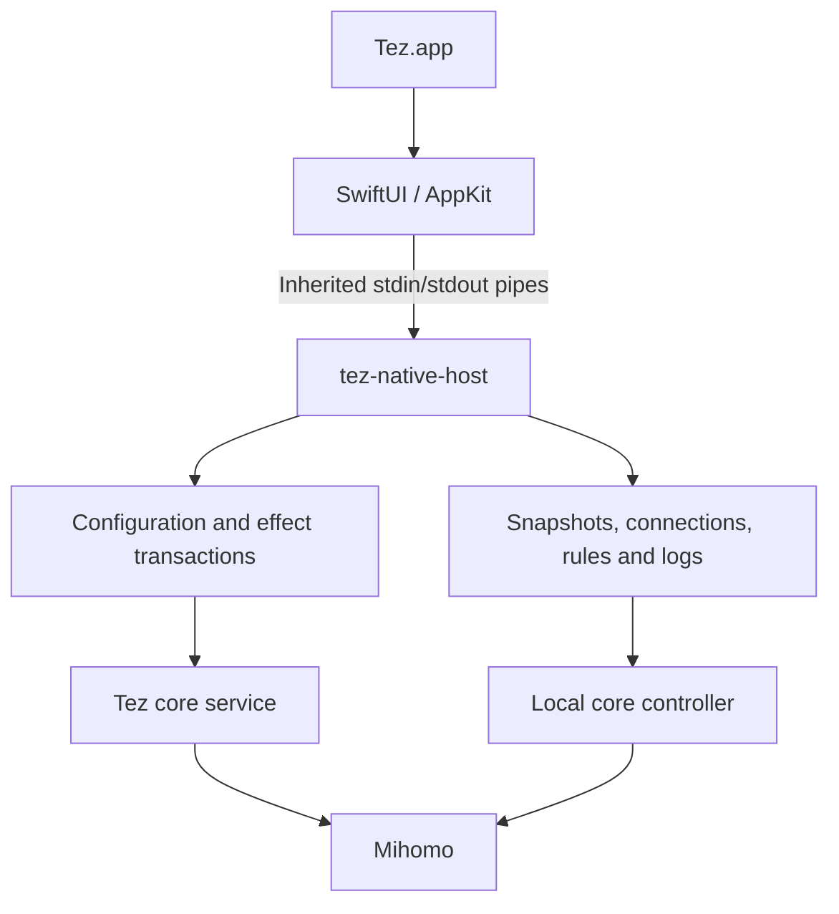

# Native Runtime Architecture

Tez presents its macOS interface in SwiftUI/AppKit and runs configuration and connection operations through the Rust backend.



## Modules

| Module | Responsibility |
| --- | --- |
| `BackendConnection.swift` | Helper supervision, request correlation, refresh, reconnect, and shutdown |
| `BackendWire.swift` / `native/backend-wire` | Frame encoding and decoding |
| `native_host.rs` | Pipe protocol and read-only dispatch |
| `native_managed.rs` | Managed startup, capabilities, command dispatch, and controlled shutdown |
| `native_workspace.rs` | Settings, subscriptions, DNS, backups, and logs |
| `native_control.rs` | Core and route operations |
| `native_ownership.rs` | Recovery, ownership claims, upgrades, and session protection |
| `core/manager` | Lifecycle and configuration application |
| `native/core-service` | Core process supervision and owner sessions |

Swift files are under `native/Sources/TezNative`; Rust host files are under `src-tauri/src`.

## Runtime Modes

- `--stdio --automatic` discovers the running service, resumes a valid owner session, or selects managed or observer operation.
- `--stdio --managed` runs the managed workspace with bundled resources and configuration transactions.
- `--stdio --inspect` and `--stdio --attach` provide read-only inspection and snapshots.
- `--stdio --isolated ROOT` runs the feature fixture with private storage and a network-disabled core.

The helper advertises its available commands in the handshake. The interface uses those capabilities to enable controls.

## Configuration and Lifecycle

Configuration writes use the backend's existing draft, validation, persistence, and effect transactions. The lock order is configuration write, configuration update, then core lifecycle.

Owner sessions bind control to the user, data root, generation, and token. Recovery restores the live runtime; an explicit claim rotates ownership while retaining the core process. Core upgrades preserve the previous version and check the candidate controller before commitment.

Session protection uses a signed temporary core copy and a session-specific controller endpoint. Staging and watchdog recovery retain the current mode. Stopping the core removes its temporary copy.

## Inventory and Checks

`parity.json` tracks the command, event, and workflow inventory. `workflows.json` identifies the source entry for each workflow.

```sh
node scripts/check-native-parity.mjs --check
```

Build and test commands are in [the native guide](../README.md). The [feature map](feature-status.md) locates the current interface and backend entry points; the [bridge protocol](wire-protocol.md) defines their transport.
