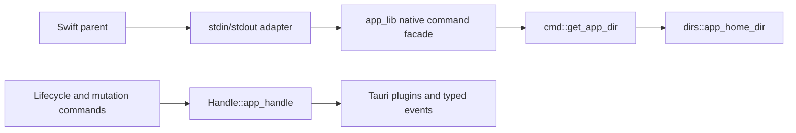

# Native Backend Boundary

The investigation below was initially source-only. Subsequently the narrow
`native-host` binary passed offline check/build, five injected tests, and a parent-run
Swift-to-host-to-Swift pipe check for the two allowlisted reads. No ordinary
application startup, configuration initialization, service, proxy, or Core was run.
References below are relative to the repository root. A full Tauri runtime host
and production process supervision remain unvalidated.

## First Reused Command

Use the existing `cmd::get_app_dir()` (`src-tauri/src/cmd/app.rs:82`).
It calls `utils::dirs::app_home_dir()` (`src-tauri/src/utils/dirs.rs:28`),
which resolves the platform data directory and app identifier without creating it.
It needs neither `APP_HANDLE`, configuration initialization, plugins, nor Core startup.
`get_system_hostname()` is another independent read (`src-tauri/src/cmd/network.rs:53`).

Do **not** classify `get_verge_config()` as strictly read-only on first access.
Its path is `cmd/verge.rs:13` -> `feat/config.rs:52` -> `Config::verge()` ->
`Config::global()` (`config/config.rs:38`). The global initializer also calls
`IProfiles::new()`. That loader clears invalid profile home URLs and saves
`profiles.yaml` when changed (`config/profiles.rs:127`, `:137`).
`IVerge::new()` itself reads YAML and normalizes `/home` in memory (`config/verge.rs:333`).

## Existing Dependency Boundary

- `cmd` is private (`src-tauri/src/lib.rs:4`). Add a narrow public facade inside
  `app_lib`; the external host cannot directly call `app_lib::cmd` today.
- `ipc::builder()` is a Tauri/Wry invoke registry, not a generic dispatcher
  (`src-tauri/src/ipc.rs:3`). Native transport must call functions explicitly.
- `APP_HANDLE` is a `OnceLock<AppHandle>` (`lib.rs:28`). `Handle::app_handle()`
  panics before initialization; `Handle::mihomo()` resolves managed plugin state
  (`core/notify/handle.rs:33`, `:38`). Events also cross this boundary (`:95`).
- Data paths do not need Tauri, but resource paths use `app_handle.path()`
  (`utils/dirs.rs:38`). Autostart uses its plugin (`core/autostart.rs:26`).
- Core sidecar startup accesses the Mihomo plugin, writes generated runtime
  configuration, and uses the shell plugin (`core/manager/state.rs:162`, `:184`).
  Its stored child type is a shell-plugin `CommandChild` (`core/manager/mod.rs:17`).
- Configuration mutation is not just persistence: the executor runs ordered
  effects before saving and publishes after commit (`feat/executor.rs:132`, `:163`).
  Extraction must retain the locks, effect registry, rollback, and typed events.

## Startup Paths With Effects

Do not call `app_lib::run()` for the first transport proof.
Before Tauri setup, it enters the production launch guard and singleton check
(`lib.rs:168`, `:185`); singleton locking creates directories/files
(`utils/server.rs:285`). Setup initializes work directories/configuration/logger
and installs autostart/deep-link/window-state plugins (`lib.rs:224`).
`init_config()` migrates logs, creates directories/configuration, validates/fixes
configuration, and schedules log deletion (`utils/init.rs:488`).
`resolve_setup()` runs profile migration and user startup scripts, detects service
state, creates a webview, reconciles TUN, copies resources, initializes DNS/runtime,
starts network monitoring/Core/tray/timers/hotkeys/backup/updater
(`utils/resolve/mod.rs:55`). The updater can install and restart (`:169`).
The existing exit callback can invoke cleanup/quit; it is not an inert host shutdown
(`lib.rs:395`, `:414`).

## Exact Next Implementation

Add a separate binary entry that calls a small `app_lib` facade for an explicit
`get_app_dir` allowlist. Read one JSON request per stdin line, echo its request ID,
and return the existing command's value/error. Reserve stdout for protocol frames;
send diagnostics to stderr. EOF exits without entering legacy app cleanup.
Unknown commands fail without initialization. This proves real backend reuse,
not feature parity. It does not require a Tauri event loop or Tokio runtime.

A later no-webview Tauri host is a separate startup function, not `run()` with a
hidden window: initialize `APP_HANDLE` and only required plugins, omit both resolve
setup functions and all window/tray/deep-link/hotkey callbacks. The current webview
is explicitly created by `init_window()` (`utils/resolve/mod.rs:239`). Source
structure supports this candidate, but a build/runtime probe must establish Tauri
event-loop behavior and plugin assumptions. Do not claim that probe passed.
Compared with immediate backend extraction, this retains existing lifecycle/plugin
contracts; it also retains Tauri/Wry dependencies. True extraction must replace
the handle, Mihomo client, process owner, resource resolver, and event sink first.
The parent owns that architecture decision and authorization for lifecycle effects.
