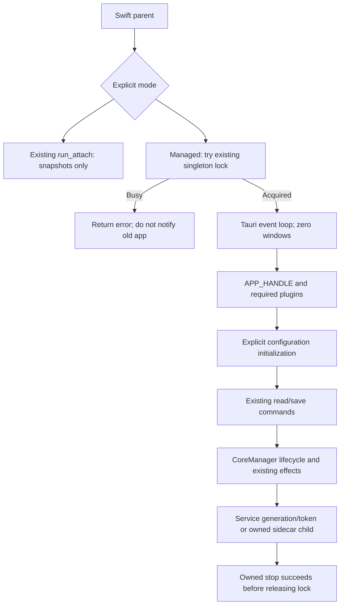

# Managed Native Runtime Boundary

This began as a source-only audit for the parent-approved native migration.
The guarded managed host and injected protocol tests now exist in source.
This document does not authorize launching a host, starting/stopping a Core,
contacting the live service, changing network settings, or writing live
configuration. The existing `run_attach` path remains inert and separate.

## Acceptance Status

Managed activation is not enabled in the native UI. Attach remains the available
real-data mode and does not acquire Core lifecycle ownership or expose mutation
commands. Managed source code and a successful offline compile/test do not mean
that production activation has passed acceptance.

Preview-owned Core/resource packaging passed static and real isolated-core checks
on 2026-10-27. Two signed cores and four database files are independent copies.
The host deliberately
refuses incomplete resources, symlinks to borrowed binaries, active/unresolved
service ownership, and a live unowned sidecar socket. It must not borrow assets
from the old application or start a Core to discover whether takeover is safe.

Swift EOF supervision passed mock failure tests and a real isolated-core session.
The production managed Tauri/CoreManager exit path remains unaccepted. It attempts bounded
controlled shutdown on pipe termination, reports a sanitized diagnostic when
shutdown fails, and retains the process/lock when ownership is unresolved.
Windowless Tauri event-loop behavior, production service/sidecar exit,
and proxy/DNS restoration still require a separately authorized integration
session. No successful real managed lifecycle session is claimed here.

The explicit `--stdio --isolated ROOT` path is a fixture-only experiment. It
creates a new private directory, runs its own bundled child, and accepts only
network-disabled fixtures. It reuses profile revision writes and pure route
validation, not the production configuration transaction or CoreManager. Its
successful writes and EOF shutdown must not be counted as production takeover.

## Read-Only Production Preflight

Run `node native/preflight-managed.mjs ABSOLUTE_APP_PATH` from the repository
root. Optional `--data-dir ABSOLUTE_EXISTING_DATA_DIR` changes only the inspected
source. The script verifies bundle/core signatures and the core manifest, checks
configuration metadata and hashes, captures digests of system proxy/DNS state,
and lists only relevant process IDs and executable basenames. It never launches
the helper, opens the singleton lock, contacts the service, creates a backup or
configuration, signals a process, or modifies networking. Exit code 2 means the
report has blockers; a green package check is not takeover authorization.

Current production blockers are concrete, separate from fixture acceptance:

- The packaged helper's `Helpers/../Resources` layout matches the inspected
  Tauri 2.12.4/tauri-utils 2.10.2 macOS resolver. Shell 2.5.0 resolves sidecars as
  executable siblings, matching `Contents/Helpers`. This is source evidence;
  no production Tauri event loop or actual AppHandle resource resolution has
  been executed. CoreManager startup must still be checked after user-approved
  ownership transfer, without bypassing the idle-service or singleton gates.
- The current service gate also refuses an absent/unreachable service and a
  status response without explicit idle data. Standalone Sidecar activation on
  a machine without an installed service is therefore not yet prepared. A
  separately reviewed absence proof is required; an ambiguous status must not
  be reclassified as permission to start.
- There is no native takeover transaction that creates a confirmed backup and
  records a durable rollback plan before `Config` initialization. The loader
  and runtime generator have the writes listed below. File hashes are evidence,
  not a restorable backup, and the isolated fixture does not exercise scripts,
  profile enhancement, active-runtime validation rollback or service staging.
- Ordinary stop clears the proxy through existing CoreManager semantics. It
  does not itself restore an arbitrary previous client's networking baseline.
  The user-approved cutover must capture the prior source/owner/network state
  and verify startup and rollback against that baseline.
- Managed EOF now restores public DNS explicitly after an owned core is
  confirmed stopped. `is_exiting` suppresses queued DNS synchronization; it
  must not suppress final restoration. The restoration function keeps its
  existing bounded process-group cleanup, not a new cancellation timeout.
  Restore errors retain the process and lock instead of reporting safe exit.
- The `NotRunning` early return deliberately avoids touching DNS when this
  session never owned a running core. It does not yet distinguish that case
  from a previous owned start/stop failure that left DNS cleanup unresolved.
  Durable effect ownership and recovery for that state remain pending.
- On a failed managed shutdown, Rust retains its event loop and singleton lock,
  and Swift retains the child and blocks reconnect/app exit. Swift can wait
  again, but the failed Rust pipe worker does not yet offer a retry/recovery
  command. This fail-closed state needs a user-visible recovery path before
  production activation.
- Remaining native parity obligations must be accepted before replacement.
  Stopping the old core, enabling the new core, or changing networking requires
  a fresh user confirmation. The preflight has no force/confirm bypass option.

## Decision Boundary

Reuse the existing backend inside a separate no-webview Tauri/Wry startup path.
Do not call `app_lib::run`, `resolve_setup_async`, or `resolve_setup_sync`.
Do not convert `run_attach` into a managed session. The parent owns the final
architecture and the separately authorized production activation.

## Exclusive Lock, Without Raising the Old Client

`server::check_singleton` is not suitable (`src-tauri/src/utils/server.rs:50`).
When the lock is held, it retries and calls `notify_existing_instance`.
On macOS that sends `/commands/visible` (`:129`), which restores the old window
(`:177`). It also starts an HTTP/PAC server when it wins. Neither behavior is
necessary for a pipe-owned helper.

Minimum new internal API: expose a narrow lock-only acquisition wrapper around
the existing `open_instance_lock` and `try_lock_instance` (`:285`, `:312`).
Use `dirs::preinit_app_data_dir()/singleton-instance.lock`, not a Preview-specific
filename or identifier. Keep the returned `File` alive for the managed lifetime.
On contention, return a stable error immediately. Do not read/rewrite the instance
record, notify the primary, retry takeover, unlink the lock, or terminate anyone.

On Unix, the existing implementation creates the parent directory, opens the
ordinary file with `O_NOFOLLOW`, sets mode `0600`, and calls
`flock(LOCK_EX | LOCK_NB)`. `EWOULDBLOCK`/`EAGAIN` means busy; other failures are
errors. Closing the owned descriptor releases the lock. Keep the same inode;
deleting a locked file would permit two owners to lock different inodes.
`INSTANCE_LOCK` currently retains the normal client's file for process lifetime
(`:39`, `:106`). A managed wrapper can retain its own RAII file instead.

This excludes clients using this repository's lock and data root. It does not
prove that an older installation with a different identifier or lock scheme is
absent. A separate service ownership check remains necessary.

## Minimal Host Setup

Create a distinct `run_managed` entry. Build a Tauri application on the process
main thread, explicitly clear `context.config_mut().app.windows`, and install no
webview/window builders. The current configuration contains no window declaration;
the legacy window is created explicitly by `resolve::init_window`
(`src-tauri/src/utils/resolve/mod.rs:239`). Keep the event loop alive while the
blocking pipe reader runs off the main thread. Tauri event-loop behavior for a
helper under `Contents/Helpers` still requires an isolated build/runtime probe.

Required existing plugin state for the scoped macOS command paths:

| Plugin | Reason |
| --- | --- |
| `tauri_plugin_shell::init()` | Both YAML validation and Core spawn use `app_handle.shell().sidecar(...)` (`core/validate.rs:367`, `core/manager/state.rs:193`). |
| `tauri_plugin_mihomo::Builder` | `Handle::mihomo()` resolves managed state (`core/notify/handle.rs:38`); use `Protocol::LocalSocket` and the initial guarded controller IPC path as in `lib.rs:77`. Core start later changes the socket path. |
| `tauri_plugin_clash_verge_sysinfo::init()` | `RealEnv::publish` calls `set_app_core_mode` on every Run State publish (`core/runstate/env.rs:106`). |
| `tauri_plugin_notification::init()` | Proxy guard failure can call desktop notifications without a window (`core/proxy_control.rs:657`, `core/notify/desktop.rs:33`). Retain unless that existing path is explicitly replaced. |

Set `APP_HANDLE` exactly once in setup, before configuration or notifications.
`Handle::app_handle()` otherwise panics (`core/notify/handle.rs:33`). Existing
typed notifications do not require a webview: they schedule main-thread dispatch,
then emit only when `main` exists (`core/notify/notification.rs:337`). They do not
automatically reach Swift; the pipe adapter must publish its own snapshots/events.

Clipboard, process, global-shortcut, fs, dialog, opener, deep-link, HTTP, updater,
autostart, window-state, tray, timers and hotkeys are outside these scoped paths.
Do not call the broad `app_init::setup_plugins` merely to obtain shell/Mihomo.
Do not install updater/devtools or launch background startup scripts.

Use `AsyncHandler`/Tauri's async runtime for backend work
(`process/async_handler.rs:8`), not a second runtime whose lifetime can cancel
backend tasks. Keep stdout exclusively for framed protocol data. Diagnostics
belong on stderr or in files; independently verify third-party logging output.

## Initialization Is Not Read-Only

| Entry | Effects and boundary |
| --- | --- |
| `Config::profiles/verge/clash/runtime` | Every accessor initializes the same `OnceCell`, loading all three source configurations (`config/config.rs:38`). `IProfiles::new` clears invalid `home` URLs and can save `profiles.yaml` (`config/profiles.rs:103`, `:137`). |
| `init::init_config` | Migrates legacy logs, creates directories/default files, validates/fixes Verge configuration, and schedules log deletion (`utils/init.rs:489`, `:430`, `:450`). Fail errors upward; do not reuse the legacy logging-and-continue wrapper. |
| `logger::init` | Reads Config, creates log writers and installs a global panic hook (`core/logger.rs:15`, `:36`; `crates/clash-verge-logging/src/lib.rs:178`, `:195`). It is not an inert prerequisite for lock acquisition. |
| `Config::init_config_before_window` | Ensures global Merge/Script profile entries/files, then sets locale (`config/config.rs:79`, `:125`). Safe to reuse without creating a window, but only after ownership and write authorization. |
| `Config::init_runtime_config` | Probes/resolves mixed-port conflicts, generates/validates runtime YAML, writes runtime config, can persist a fallback port, and synchronizes DNS override (`config/config.rs:100`). Validation executes the Core with `-t`; generation can run profile scripts. |
| `init::init_resources` | Copies/upgrades four geographic database files into the data root (`utils/init.rs:508`). It can also try to create a resource directory. Preflight readable resources instead of silently creating a bundle directory. |
| `SERVICE_MANAGER.detect_startup_status` | Probes service health/install evidence, publishes Run State, and can trigger TUN reconciliation (`core/service.rs:1889`, `core/runstate/env.rs:95`). It is not an ownership claim or a pure value read. |
| `CoreManager::init` | Immediately calls `start_core`; retries can resolve and persist mixed-port fallback (`core/manager/mod.rs:280`). Do not call it merely to initialize command handling. |

Logger setup is useful for managed operation, but no scoped API requires logging
to acquire the singleton lock. Install it only after the managed data root is
fixed. The existing facade must not swallow initialization errors and advertise a
ready managed session after failure.

## Reused Command and Lifecycle Contract

`cmd::read_profile_file(index)` (`cmd/profile.rs:507`) uses existing profile
metadata/path checks. Its first Config access has the loader effects above.
`cmd::save_profile_file(index, Some(data))` (`cmd/save_profile.rs:20`) writes the
file, validates it, restores original bytes on invalid input/error, and calls
`CoreManager::update_config_forced` when it affects the active runtime (`:168`).
Merge/Script saves can trigger an on-change backup (`:87`). Do not replace this
with a direct native file write. Preserve `ValidationOutcome`; successful
transport is not equivalent to successful validation/application.

Exact lifecycle entries are `CoreManager::global().start_core()`
(`core/manager/lifecycle.rs:355`), `.stop_core()` (`:729`), and `.restart_core()`
(`:775`). Preserve their config-update/lifecycle locks. Start applies proxy/DNS
after readiness; stop clears/stops the proxy guard and can synchronize DNS;
restart executes controlled replacement. These are OS effects, not just process
signals. Do not call internal start/stop functions to bypass these contracts.
Start can return `Ok(())` while waiting for service, so readiness is determined
from Running Mode/startup error, not only the command result (`:624`).

Service version readiness is not ownership. A successful
`start_with_existing_service` generates a random token, submits it with the
runtime bundle, and retains the returned generation plus that token
(`core/service.rs:896`). Only then may CoreManager mark Service mode (`core/manager/state.rs:362`).
`stop_core_by_service` requires both current-owner credentials and the active
session proof (`core/service.rs:1474`). Owner monitoring compares active status
and generation (`:189`) and handles displacement. Do not synthesize Service
mode from an attach snapshot or borrow an old process's proof. Do not expose
install/uninstall/reinstall or `continue_with_sidecar` through this narrow API.

Unresolved activation condition: the local source proves session-protected stop,
but not whether the external service permits a new same-user StartClash to
replace an orphaned owner's session. Service dependency source was not available
in the inspected local Cargo cache. Before production activation, inspect that
implementation or refuse start when a read-only status probe reports active
ownership without this process's proof. Do not use a start request as a probe.

## Preview Bundle Resource Contract

With `TEZ_NATIVE_BUNDLE_CORE=1`, `native/build-preview.sh` embeds independent
signed Core siblings and geographic databases alongside `tez-native-host`.
The package manifest verifies their hashes; an ordinary UI-only build removes
stale optional core assets rather than silently retaining an old version.
`service_core_path` resolves `current_exe().with_file_name(core_name)`
(`core/service.rs:544`), so the managed helper's Core must be its own sibling in
`Contents/Helpers`, not in the old application's bundle. Shell sidecar resolution
matches the inspected shell plugin's sibling resolver. The production runtime
still requires acceptance; both supported core names match
`IVerge::VALID_CLASH_CORES`.

Database paths independently use `app_handle.path().resource_dir()/resources`
(`utils/dirs.rs:38`). Ship Preview-owned database assets in the resulting bundle
resource path, or introduce a managed-only explicit resource resolver with
containment checks. Do not redirect to an old bundle or change global production
resource behavior to repair Preview packaging. `verge-dev` also stages service
cores under `HOME/Applications/.clash-verge-rev-dev`; that feature is not an
isolation strategy (`core/service.rs:431`, `:544`).

## Exit and Isolated Validation

On parent EOF, stop accepting mutations and serialize shutdown after in-flight
work. Only a managed session that acquired the singleton lock and owns its Core
may call the controlled `stop_core`. Set `Handle::is_exiting` to stop new backend
work, preserve the owned service proof until stop, explicitly restore public DNS
after confirmed stop, then flush the logger. Keep
the lock until controlled stop succeeds. A failed stop must report failure;
silently dropping the lock would let another client race a still-running Core.
The parent must preserve ownership on failed shutdown or explicitly resolve it.

Do not reuse `feat::quit`: it applies/saves all drafts before cleanup and exits
the Tauri app (`feat/window.rs:133`). Do not install legacy Exit/ExitRequested
callbacks (`lib.rs:395`) in the no-webview host. Do not run global cleanup for
attach, rejected lock acquisition, or partially initialized sessions without an
owned Core. Sidecar termination must use CoreManager's stored child, never a
process-name search.

Safe next implementation validation, without live configuration/network:

1. Test lock-only acquisition with injected absolute temporary paths. Use two
   processes to establish busy/refusal/release; verify no record/HTTP operations.
2. Test managed allowlist/parameter/error dispatch with injected operations.
   Verify attach continues rejecting all mutations and lifecycle commands.
3. Build without running the app. Statically inspect Preview packaging for owned
   helper/Core/resource paths and validate signatures without launching.
4. Probe no-webview Tauri setup only after every data, resource and IPC resolver
   has an explicit test override. Disable all config initialization, service
   probes, OS proxy/DNS effects and Core spawn for that probe. Assert zero windows.
5. Test command persistence/rollback with isolated Config roots and injected
   validation/runtime effects. Existing production `app_home_dir` has no override
   (`utils/dirs.rs:28`); changing `HOME` alone does not isolate macOS per-user
   sidecar IPC (`utils/dirs.rs:207`) or privileged service identity.

Real start/stop/restart integration remains outside an offline temporary-directory
test. It requires separate activation authorization and either a genuinely
isolated fake effects environment or a controlled ownership/network session.
The original audit executed none of those effects. Later source implementation
does not change the incomplete activation acceptance above. Offline test results
must be reported separately with their actual command and coverage.
